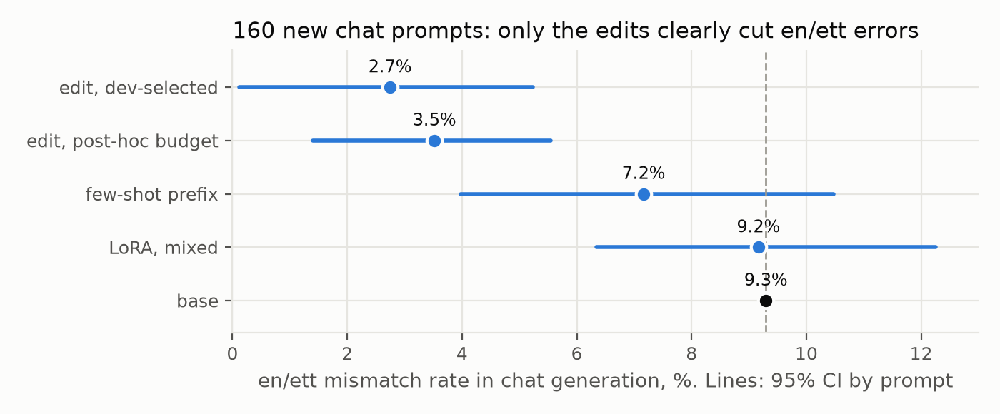
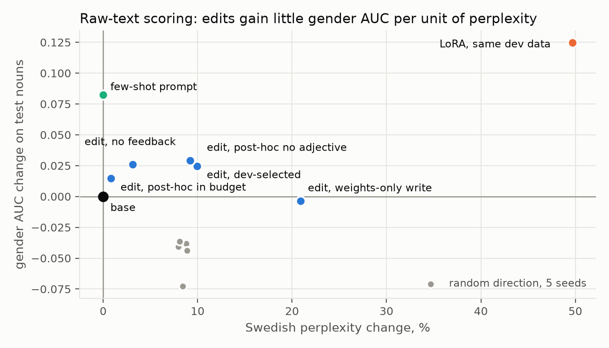

# Can a direct weight edit fix Swedish en/ett agreement? A test of weight-space programming for SE.LLMA

**Verdict.** The pre-registered hypothesis fails, and weight-space programming is not worth investing in as a research direction for SE.LLMA. A rank-1 edit to one `down_proj` matrix of Qwen3.5-0.8B carries a real, gender-specific signal. But on the pre-registered target, gender AUC on held-out nouns, it gains only +0.025. That is less than a few-shot prompt, it costs Swedish perplexity, and dev gains shrink by half or more on held-out data.

One narrow, exploratory result goes the other way. In chat-mode generation, on 160 prompts written after all choices were made, a small edit chosen on dev data inside a 1% perplexity budget cut en/ett errors from 9.3% to 3.5%. That beats both the prompt and LoRA there.

The diagnosis is worth keeping. The chat model gets en/ett wrong in about **1 noun phrase in 10** in free Swedish text, and its gender use is weaker than a 4-letter suffix rule. The pretrained-only checkpoint is clearly better at gender, so much of the error comes with post-training.

Files: `DESIGN.md` has the plan, designs and self-review. `GETTING_STARTED.md` explains how to reproduce. `TOOLING.md` is the AI-tool log. `report.pdf` is this note plus the figures.

## 1. The paper, read critically

*Sparks of Weight-Space Programming* (Takehi, Teoh, Zhang, Khattab, Nov 2026) claims that a frontier LLM, which the authors call Astra, can read and write network weights "like code".

**Strongest evidence.**
- **Exp 3.** Astra named the induction heads of small character-level transformers from 4 middle blocks, checked against a ground truth it never saw.
- **Exp 4.** It wrote a one-shot, no-tool edit of a 171k-parameter controller, taking it from 0 of 256 to 1024 of 1024 successes.
- **Exp 8.** The Qwen3.5-0.8B edit is public. An independent re-run scored 51.0% on MATH-500. The logs include a norm-matched random direction that gave only +1.6 points.

**Main limitations.**
1. **The one LLM-scale writing result is feedback-driven search.** In Exp 8, each of the 50 forward passes returned practice accuracy, a paired difference and failure cases. The final edit was the top-scoring point of about 8 candidates that varied strength and size. At 10 and 25 passes MATH-500 was 12.3 and 14.1, against 7.9 for base. So most of the gain appears only with the full search budget. A third-party run with a different model reached 56.2 at 10 passes with *different* edits. Many edits stop the loop, which argues against one specific reasoned-out direction.
2. **The baseline is a truncation artifact.** 93% of base answers hit the 32,768-token limit. The sampling settings differ from Qwen's own recommendation for thinking mode. Qwen's model card warns that this model "is more prone to entering thinking loops". The paper reports no thinking-off number and no longer-budget baseline.
3. **The edit family is known.** I checked the published tensors. The edit is rank 1, with the top singular value holding 99.999% of the energy, on 64 columns of `down_proj` in layers 15 and 19. Its exact form is `W − 6·uuᵀW`. That does not *remove* a direction. It flips its sign and amplifies it 5×. Single-direction edits of this kind follow Arditi et al. 2024, which the post does not cite.
4. **Reading weights fails exactly where it would matter for LLMs.** From the weights alone, Astra could not find the sycophantic Gemma 3 270M, in any of 4 attempts. It also could not improve Gemma at all.

**Unsupported conclusions.**
- "Weight-Space Programming would allow such targeted fixes without any retraining" generalizes from one obstacle, the looping, that 50 scored passes found.
- "Reads weights like code" generalizes from toy networks to LLMs.

The authors' own summary, "editing … could remove an obstacle … but could not add an ability", is the claim worth testing.

**Reasoning versus feedback, per experiment:**

| Experiment | Forward passes or score feedback |
|---|---|
| Exp 1–5, 7 | none, or tools only. All on small networks |
| Exp 6, Go | up to 50 passes of games, edits kept if they won more |
| Exp 8, Qwen | 10, 25 or 50 scored passes. Headline only at 50 |

## 2. Hypothesis

**Question.** Is Qwen3.5-0.8B's en/ett gender error an *obstacle*, a gender signal that exists but is too weak where the decision is made, so that a rank-1 edit amplifying it fixes the error without damage? Or is the ability missing?

**Why it matters to SE.LLMA.** SE.LLMA adapts open models and wants "finer linguistic nuances". If Swedish grammar errors are obstacles, cheap post-hoc patches are an option. If not, the fix must come from data and tokenizer work in continued pretraining. Grammatical gender is a core Swedish feature that is easy to measure without a judge model.

**Pre-registered rule, in `DESIGN.md` §4.9.**
- **Validated** if all of these hold:
  - test gender AUC rises by at least 0.03,
  - the gain exceeds all 5 random-direction controls,
  - Swedish perplexity rises less than 2%,
  - non-gender Swedish BLiMP drops less than 1 point.
- **Falsified** if any of these holds:
  - the gain is within the random spread,
  - the gain comes only with damage,
  - a prompt or LoRA does as well more cheaply.

## 3. Method

- **Model.** `Qwen/Qwen3.5-0.8B` at revision `2fc0636471`, the paper's own subject, run in fp32 on Apple MPS. Seed 0.
- **Lexicon.** 10,791 nouns, 2,772 of them neuter. They come from FineWeb-2 Swedish by counting "en X" against "ett X" and checking the definite suffix -en against -et. A hand audit puts precision at about 98%. Nouns are split **by lemma** into dev and test, 40/60.
- **Items.** Each noun goes into 3 carrier sentences. **Dev and test use different sentences.** The test set is 250 neuter and 250 common nouns × 3 sentences.
- **Primary metric: gender AUC.** Per sentence, do the scores `log P(noun | …ett) − log P(noun | …en)` rank neuter nouns above common nouns? I averaged over sentences.
  - I first used plain two-way accuracy. It gave 31% on common nouns. That turned out to be an offset: after *en*, which also means "one", every noun is less likely.
  - AUC removes this offset. So does **mismatch mass**: after *ett*, the share of balanced noun probability on common nouns, and the reverse.
- **Edit.** `W ← W + w rᵀ` on one layer's `mlp.down_proj`, the tensor the paper edited.
  - `r` is the mean ett-minus-en difference of the MLP input over 1,200 paired dev sentences, with the mean activation projected out. This removes a constant push on all text.
  - `w` is scaled so the edit adds k× the existing ett-minus-en difference in the residual stream.
- **Feedback ladder.**
  - Write direction from the unembedding alone, with no forward passes.
  - Layer by a separation heuristic and k=1, with no score feedback.
  - 72 dev evaluations over 24 layers × k ∈ {1, 2, 4}.
  - Gradient: LoRA with r=8 on `down_proj`, 2 epochs on the same 1,200 dev sentences.
- **Controls.**
  - The same edit with a random write direction of equal norm, 5 seeds.
  - A few-shot prompt with 8 gender examples.
  - LoRA.
  - A spelling-only classifier on the last 1–4 letters.
- **Regressions.**
  - Perplexity on 150 FineWeb-2 Swedish test documents and 150 WikiText-103 English documents.
  - 400 pairs from each of 5 LiU Swedish BLiMP sets: 2 gender sets as external targets, plus finite verbs, passive, and number agreement.
- **Free generation.** 40 new Swedish prompts, greedy decoding, 200 tokens, thinking off. An NP counts as a mismatch when *en/ett* precedes a lexicon noun of the other gender, directly or after one word. 95% CIs come from a bootstrap over prompts.

## 4. Results

**Test set, 500 held-out nouns.** Δ is against base. The 95% CI comes from a paired bootstrap over nouns.

| Arm | gender AUC | Δ, 95% CI | AUC 1-token / multi-token | Swedish ppl | finite-verb BLiMP |
|---|---|---|---|---|---|
| base | 0.649 | | 0.705 / 0.636 | 53.5 | 0.802 |
| edit, no feedback, L20 k=1 | 0.675 | +0.026 [+0.011, +0.040] | 0.710 / 0.665 | +3.1% | 0.782 |
| edit, dev-selected, L22 k=2 | 0.674 | +0.025 [+0.002, +0.047] | 0.701 / 0.662 | +9.9% | 0.782 |
| edit, weights-only write direction | 0.646 | −0.004 [−0.040, +0.033] | 0.731 / 0.627 | +20.9% | 0.795 |
| random direction, 5 seeds | 0.576–0.612 | −0.036 to −0.073 | | +8.0 to +8.9% | 0.775–0.800 |
| few-shot prompt | **0.732** | +0.082 [+0.050, +0.118] | 0.818 / 0.727 | n/a | n/a |
| LoRA on the same dev data | **0.774** | +0.125 [+0.085, +0.169] | 0.844 / 0.767 | **+49.7%** | 0.873 |
| LoRA, mixed 1:1 with general Swedish text | **0.807** | +0.157 [+0.119, +0.197] | 0.835 / 0.803 | −44.6%, see point 8 | 0.930 |
| *reference:* pretrained-only `Qwen3.5-0.8B-Base` | 0.765 | +0.116 | 0.816 / 0.754 | −38.0%, see point 8 | 0.878 |
| *post-hoc:* edit, no-adjective direction | 0.678 | +0.029 | 0.722 / 0.668 | +9.2% | 0.785 |
| *post-hoc:* best dev point within 2% ppl, L22 k=0.5 | 0.664 | +0.015 | 0.715 / 0.651 | +0.8% | 0.800 |

Full metrics, including both gender BLiMP sets, mismatch mass and English perplexity, are in `results/arms.json`, `results/posthoc_*.json` and `results/base_model_check.json`. With 400 pairs per BLiMP set, differences of about 2 points are within noise.

**Free generation in chat mode, 200 prompts.** These are the 40 original prompts plus 160 written after all edit choices. Greedy decoding, thinking off, 200 tokens. The 95% CIs come from a bootstrap over prompts. The 40-prompt pilot is in `results/generation.json` and points the same way.

| Arm | mismatch, all 200 | Δ, 95% CI | mismatch, new 160 only | Δ, 95% CI | distinct 4-grams | "nyckel" per 1k words |
|---|---|---|---|---|---|---|
| base | 10.3% (136/1326) | | 9.3% (95/1022) | | 0.794 | 0.5 |
| edit, dev-selected, pre-registered | 2.5% (33/1313) | −7.7 [−10.2, −5.4] | 2.7% | −6.5 [−9.2, −4.1] | 0.684 | **36.0** |
| *post-hoc:* budget edit, L22 k=0.5 | **3.8%** (57/1510) | −6.5 [−8.7, −4.4] | **3.5%** | −5.8 [−7.9, −3.7] | 0.784 | 3.8 |
| few-shot prefix | 6.9% (138/1987) | −3.3 [−6.1, −0.3] | 7.2% | −2.1 [−5.3, +1.2] | 0.650 | 0.0 |
| LoRA, mixed with general Swedish | 9.4% (114/1208) | −0.8 [−3.7, +2.0] | 9.2% | −0.1 [−3.0, +3.0] | 0.818 | 0.0 |

A system instruction to "use the right article" did not help in the 40-prompt pilot, 14.9% against 13.5%. Sources: `results/generation_200.json` and `results/generation_heldout160.json`.

**What the numbers say.**
1. **The pre-registered hypothesis fails.**
   - The dev-selected edit gains +0.025 AUC, below the 0.03 threshold, and costs 9.9% Swedish perplexity.
   - The best dev point within the perplexity budget gains only +0.015 on test.
   - It does beat all random directions, which *lower* AUC at the same norm. So the direction is real, but weak.
2. **Dev gains do not transfer.** Selection on 72 dev evaluations found +0.063 on dev but +0.025 on test. The budget point went from +0.032 to +0.015. More feedback bought fit to the dev sentences, not a better edit. The no-feedback edit did as well on test.
3. **The prompt beats the edit on the target, with no weight change, but not in chat generation.** A few-shot prompt gives +0.082 AUC. In free generation the prefix helps less than the edits, and the model parrots the 8 example nouns, see point 9.
4. **Contrast directions leak.** One dev sentence contained the adjective *ny/nytt*. The ett-minus-en direction learned "the previous token was *ny*", and the tokenizer splits *nyckel* as ` ny`+`ck`+`el`. The edited model then wrote "nyckel" 56× more often.
   - Perplexity did not reveal this. Only reading generations did.
   - Removing the adjective sentence removed the leak. This is a post-hoc fix and is labeled as such.
5. **Capability or suppression: partly suppressed, but not by something one direction removes.**
   - The information exists. A linear probe on layer 22 reads noun gender at 0.78 balanced accuracy, against 0.46 for shuffled labels. A suffix rule alone gets AUC 0.83. Behavior is only 0.65.
   - 8 prompt examples raise AUC by 0.08, which suggests latent ability.
   - But amplifying the model's own article signal helps clearly only in layers 18–23, `figures/layer_sweep.png`. In layers 0–15 it does nothing or hurts.
   - LoRA's +0.125 is fully within what suffix rules learned from 400 dev nouns can explain, 0.83. So it is not evidence of unlocked knowledge.
   - The strongest evidence for suppression is at the checkpoint level. The pretrained-only checkpoint scores 0.765, the post-trained chat model 0.649. The ability exists after pretraining and weakens in post-training. Part of this gap may be format, see point 8.
6. **Weights-only reading did not work here.** The first-token unembedding row holds no gender, with a probe at 0.53. A write direction taken from it helped single-token nouns, 0.705 → 0.731, but hurt the 87% of nouns that are multi-token.
7. **Side check, Design B: the paper's own edit does not hurt Swedish.**
   - Swedish perplexity 53.5 → 52.3, English 39.5 → 37.5.
   - All 5 Swedish BLiMP sets equal or better, gender AUC 0.649 → 0.668.
   - Source: `results/paper_edit_audit.json`.
8. **Likelihood metrics here partly measure format.** The subject is a chat model, and all likelihoods are scored as raw text after `<|endoftext|>`.
   - The mixed LoRA lowered Swedish perplexity by 45% and *English* perplexity by 29%. Three hundred LoRA steps on Swedish snippets cannot teach that much English.
   - The pretrained-only checkpoint lands in the same place: Swedish 33.2, English 26.1. So the mixed LoRA mostly restored raw-text calibration.
   - Read the LoRA rows, and the BLiMP gains that come with them, as format plus gender, not as gender alone. The edit and prompt rows share one format, so their comparison holds. Free generation in chat mode is the format-free check.
9. **In chat mode the ranking flips.** The format-free check is free generation.
   - The mixed LoRA, best on every likelihood metric, does not reduce en/ett errors in chat at all: −0.1 points on the new prompts.
   - The few-shot prefix is not significant there.
   - The edits are the only arms with a clear effect. The budget edit keeps diversity close to base, 0.784 against 0.794, and leaks a little "nyckel", 3.8 against 0.5 per 1k words.
   - Caveats:
     - The budget edit was picked post-hoc, from dev data only, after the 40-prompt pilot.
     - The checker only sees an article right before the noun, or one word before.
     - No human has rated the fluency of the edited text.

## 5. What this does and does not show

- **It shows** that one widely used edit family, a rank-1 contrast-direction amplification on `down_proj` like the paper's own edit, is weak and leaky on the pre-registered target. That holds whether the edit is chosen with or without feedback, and prompting and LoRA beat it there.
- **It suggests, exploratory only,** that a small, budget-constrained edit reduces en/ett errors in chat generation more than a prompt or a LoRA trained the same way. The result held on 160 prompts that were written after all choices were made.
- **It does not show** that no weight edit can fix gender agreement. It also does not test a frontier LLM acting as the "programmer", or other models.
- **Other limits:**
  - one model,
  - one phenomenon,
  - 3 carrier sentences per split,
  - a lexicon with about 2% noise,
  - a mismatch checker that misses agreement more than one word away,
  - LoRA was not tuned beyond one setting, and likelihood metrics favor anything trained on raw text, point 8.

## 6. Recommendation

**Do not invest SE.LLMA engineering in weight-space programming as a research direction.** On the pre-registered target, cheap baselines win and dev gains do not survive held-out data. The paper's own headline is feedback-driven search on an English looping problem.

**One bounded exception is worth a small check, not a program.** A dev-selected rank-1 edit within a 1% perplexity budget cut chat-mode en/ett errors from 9.3% to 3.5% on new prompts. Before treating it as a usable patch, three checks are needed:
- human grammar and fluency review of the edited output,
- a second model,
- other Swedish tasks in chat mode.

**Do adopt the diagnostic.** Free-generation en/ett mismatch and offset-free gender AUC are cheap, judge-free, and sensitive. The Qwen3.5-0.8B chat model fails about 1 noun phrase in 10 on 200 prompts. Add both to the SE.LLMA eval suite, split by token count. Run them on both the pretrained and the post-trained checkpoint of any candidate base model, because post-training can cost Swedish grammar.

**Most informative follow-up.** Run the same diagnostic and the same edit on Qwen3.5-0.8B before and after a small Swedish continued-pretraining run, about 100M FineWeb-2 Swedish tokens on one GPU. This answers three questions in one run:
1. Does Swedish data fix gender? That would be the "ability added by data" case.
2. Is the gain concentrated in multi-token nouns? That would make the tokenizer the root cause.
3. Does any edit still add value on top of continued pretraining? That decides whether editing has any place in the pipeline.

Two cheaper options:
- **Interpolate toward the pretrained weights.** Move selected late-layer matrices of the chat model part of the way toward `-Base`, and score with this harness. It is the weight edit with the strongest prior, since the pretrained checkpoint already has the ability.
- **Frontier LLM as the "programmer".** Let a frontier LLM write the `w, r` vectors from `results/probe.json` and the layer-22 weights. It would be scored by the same harness, which closes the gap to the paper's actual setup.
